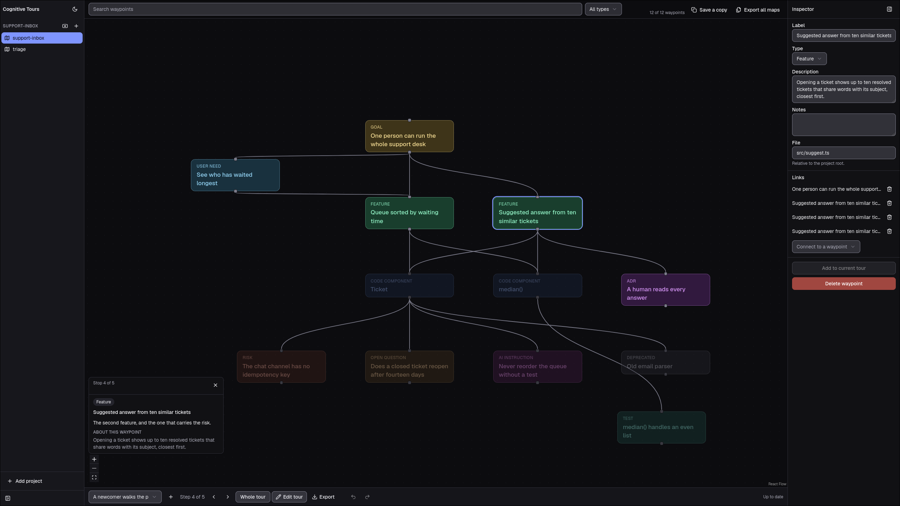

# Cognitive Tours

**Maps and guided tours of your code, written by you, linking why to how.**

[Install](#install) · [Quick start](#quick-start) · [Guides](#guides) · [The research](#the-research)



Cognitive Tours turns a software project into a graph of the things that matter —
goals, user needs, features, decisions, code, tests, risks, open questions,
deprecated parts — and lets you record why they are shaped that way. A **tour** is
an ordered walk through that graph, with a written narrative at each stop: ten
minutes of reading instead of six months of archaeology.

The map is a file in the repository, `.ctour/<name>.tour.json`. It is committed,
reviewed and diffed like the code it describes, and it travels with a clone.
Everything runs on your machine: nothing is uploaded, there is no account, there is
no server to log in to.

## Why

- **Code outruns understanding.** With AI writing more of it, teams ship code
  nobody fully understands and lose track of _why_ it is the way it is. Storey
  calls the two debts this leaves behind **cognitive debt** and **intent debt**:
  what the team no longer knows about its own system, and what it no longer
  remembers about what the system was for.
- **Writing the tour is how you get it back.** You place waypoints, connect them,
  and write the walk from why to how. Writing it rebuilds your own understanding;
  sharing it passes some of that on.
- **AI is a scaffold, not a substitute.** An agent can draft a starting map, ask
  the questions you skipped, and keep the map in step with the code. The
  understanding stays yours — a map nobody wrote by hand is a map nobody trusts.

## Where it comes from

Cognitive Tours started as research by
[Margaret-Anne Storey](https://github.com/margaretstorey) on how people understand
software. A codebase is not only its code, and questions like _why is it shaped
this way_ or _what would break if we moved this_ have no home in a repository. The
idea is twenty years old: waypoints came from TagSEA (CSCW 2006), tours of a
codebase from ICSE 2007. Both papers are in `docs/papers/`.

**This repository is the Forge build**: the same idea, rebuilt as a local-first
product you can use on a real project. The research prototype needs a deployment, a
database and an accounts conversation before it shows you a map; the Forge build
needs one command and a folder of code.

| The prototype                            | The Forge build                                           |
| ---------------------------------------- | --------------------------------------------------------- |
| A hosted site per team, with a database  | A local application, started by `ctour init`              |
| The map lives in a server                | The map is `.ctour/<name>.tour.json`, committed with code |
| One map per deployment                   | Every project and map in one window, from one rail        |
| Edits are saved when they are saved      | The file is followed live; conflicts are never silent     |
| An agent reads a public URL              | An agent reads and writes the same file over `ctour mcp`  |
| Sharing means exporting Markdown         | Save a copy, import with a preview, move a workspace      |
| A prototype with its author's own layout | Responsive at every width, real light and dark themes     |

## What a map is

A waypoint is one fact, typed, written in a sentence or two, and linked to the
waypoints around it. The ten types are not decoration: they set the colour, the
filter, and the question the waypoint answers.

| Type           | It answers                                            |
| -------------- | ----------------------------------------------------- |
| Goal           | What is this product for?                             |
| User Need      | What does someone outside the code need from it?      |
| Feature        | What does the product do about that need?             |
| ADR            | Which decision was made, and what did it cost?        |
| Code Component | Where does it live, and what is it responsible for?   |
| Test           | What promise is checked, and by what?                 |
| Risk           | What can hurt us, and how would we notice?            |
| AI Instruction | What must an agent working here know before it edits? |
| Open Question  | What do we not know yet?                              |
| Deprecated     | What is on its way out, and what replaced it?         |

Three rules keep a map worth reading:

1. **The map says what the code cannot.** A waypoint that repeats a function
   signature is noise. A waypoint that says _why_ the signature is that shape is
   the point.
2. **The map belongs to the code.** It is a file under `.ctour/`, next to the
   source — never stored in a service that outlives or forgets the code.
3. **Reading comes first.** A tour is for a person who does not know the system
   yet. Nothing on the screen matters more than the words the author wrote for the
   stop being read.

A waypoint's box grows to hold its label, so a sentence is never cut off with an
ellipsis; its size is kept in the map beside its position. A tour is an order
through waypoints with words at each stop, and it is made where it is read: the
dock creates it, and the waypoint in front of you is one press away from becoming
the next stop.

## Who this is for

Someone joining a codebase and needing to know why it is shaped this way. Someone
leaving a codebase and wanting the reason to survive them. A team that keeps
re-litigating a decision because nobody remembers the constraint that produced it.
An AI agent that has to change the code without breaking the assumptions behind it.

## Install

```bash
curl -fsSL https://raw.githubusercontent.com/Alice088/cognitive-tours-forge/main/install.sh | sh
```

One line: it installs the `ctour` command, adds nothing to your projects, and asks
for no configuration. You need Node.js 20 or newer; the installer builds the
interface on your machine the first time (a couple of minutes), then installs the
command into the machine-wide npm prefix, or into `~/.local` when that prefix is
not writable. It uses the packed release for the version on `main` when one exists,
and builds from source when that release is older than the branch, so it never
installs a stale build.

Other ways in, for people who prefer them:

```bash
npm install -g ctour                                         # once it is on the registry
sh install.sh --prefix ~/.local                              # from a checkout
npm install && npm run build:all && node dist/cli.mjs init .  # to work on it
```

## Quick start

```bash
cd ~/code/your-project
ctour init        # creates .ctour/, registers the project, prints one address
```

Open that address and the map is there. The interface is a local process; close
the terminal and it stops. When you want it back:

```bash
ctour serve       # opens the interface again, writes nothing
```

Then write a few waypoints, link them, and walk a tour. `ctour status` lists every
project this machine knows; `ctour doctor` names what is wrong and which command
fixes it; `ctour mcp install` connects the coding agent you already use so it can
read and write the same map.

Step by step, with what to click and what to expect:
[docs/QUICKSTART.md](docs/QUICKSTART.md).

## Guides

| Guide                                                         | It covers                                                                        |
| ------------------------------------------------------------- | -------------------------------------------------------------------------------- |
| [Mapping a project](docs/guides/mapping-a-project.md)         | waypoints, links, file paths, layout, several maps in one repository             |
| [Writing a tour](docs/guides/writing-a-tour.md)               | stops, narration, the reading surface, the whole-tour view, export               |
| [Working with an agent](docs/guides/working-with-an-agent.md) | `ctour mcp`, connecting Claude Code / Cursor / Gemini CLI / Codex / pi, refusals |
| [Moving maps between projects](docs/guides/moving-maps.md)    | saving a copy, importing with a preview, the whole-workspace bundle              |

## How it fits together

Three regions of state, each with one owner: the workspace registry in
`~/.ctour/workspace.json` (which projects this machine has opened), the map
document in `<project>/.ctour/<name>.tour.json` (the thing that belongs to the
code), and the running application (selection, undo history, what is being
dragged). The screen has four regions — rail, canvas, inspector, dock — and a fact
that appears in two of them is a defect, not a convenience.

The map is read and written by a local server, saved atomically, and followed while
it is open, so an edit in your editor, a `git checkout` or an agent shows up in the
interface without a reload. A coding agent reaches the same file through `ctour
mcp`, which speaks a small protocol on standard input and output and writes through
the same code the interface uses, so the two cannot disagree about the format.

The decisions, the mechanisms and the trade-offs behind that are in
[docs/ARCHITECTURE.md](docs/ARCHITECTURE.md): the reading surface, design tokens,
the map format, live sync, the offline copy, exchange, the agent protocol and
editing.

## The research

| Where                                                                                                                           | What                                                                                      |
| ------------------------------------------------------------------------------------------------------------------------------- | ----------------------------------------------------------------------------------------- |
| [Cognitive Tours: Making Understanding a Deliverable in AI-Assisted Development](https://arxiv.org/abs/2611.08456)              | the paper behind this build (ICSE 2027 demo, under review)                                |
| [From Technical Debt to Cognitive and Intent Debt](https://arxiv.org/abs/2603.22106)                                            | Storey, 2026: the research foundation                                                     |
| [Presentations by Programmers for Programmers](https://doi.org/10.1109/ICSE.2007.67)                                            | Cheng, Desmond and Storey, ICSE 2007 — tours of a codebase (`docs/papers/tours-2006.pdf`) |
| [Shared Waypoints and Social Tagging to Support Collaboration in Software Development](https://doi.org/10.1145/1180875.1180906) | Storey, Cheng, Bull and Rigby, CSCW 2006 — waypoints in TagSEA                            |
| [margaretstorey/cognitive-tours](https://github.com/margaretstorey/cognitive-tours)                                             | the original prototype this build descends from                                           |
| [An early demo video](https://www.youtube.com/watch?v=I2S5Ee3bzi8)                                                              | four minutes, October 2026                                                                |

The original prototype is self-documenting: its own map and tours describe how it
was built, and reading them is the onboarding. That habit is the point of the
product, not a curiosity of the prototype.

## Building and testing

`npm install`, `npm run dev`, `npm run test:unit`, `npm run test:e2e`,
`npm run lint`, `npm run typecheck`, and `make release` to produce the installable
`ctour-<version>.tgz` — with the test layout, the command's internals, the
environment and a troubleshooting table for every symptom the product can produce:
[docs/DEVELOPING.md](docs/DEVELOPING.md).

Feature work is specified before it is built; see `specs/`. The map format is a
contract, `specs/010-app-shell/contracts/map-file.md`: changes to ordering or field
meaning need a version bump and a reader that still opens version 1. The
constitution the work follows is `.specify/memory/constitution.md`.

## License

MIT. See [LICENSE](LICENSE).
